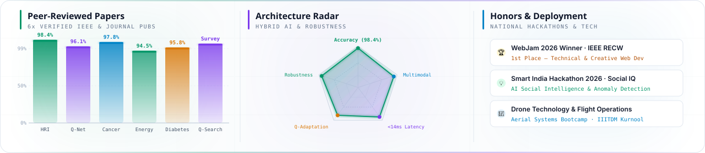
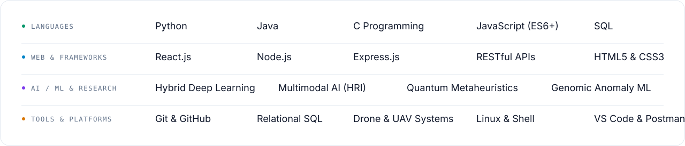

<picture>
  <source media="(prefers-color-scheme: dark)" srcset="./assets/hero-dark-3d.svg">
  
</picture>

**[GitHub](https://github.com/Bhavya-77-ctrl)** &nbsp;·&nbsp; **[LinkedIn](https://www.linkedin.com/in/)** &nbsp;·&nbsp; **[Email](mailto:matambhavyasree7@gmail.com)** &nbsp;·&nbsp; **[Publications](#-peer-reviewed-research-publications)** &nbsp;·&nbsp; **[Resume](mailto:matambhavyasree7@gmail.com?subject=Resume%20Request%20-%20Matam%20Bhavya%20Sree)**

 

Computer Science and Engineering undergraduate at **Ravindra College of Engineering for Women (RCEW)**, Kurnool (CGPA: **8.74/10**). I conduct academic and applied research at the frontier of **Artificial Intelligence, Quantum-Inspired Computing, and Computational Biology**, while engineering scalable, responsive web architectures using modern full-stack technologies (**React.js, Node.js, Express.js, and SQL**).

Co-author of **6 peer-reviewed research publications** in premier IEEE international conferences and journals, advancing multimodal speech and gesture recognition for human-robot interaction, hybrid deep learning for early cancer gene anomaly detection, adaptive routing across quantum communication networks, and quantum-inspired metaheuristics. Winner of **WebJam 2026** (IEEE Educational Society) and innovator at the **Smart India Hackathon (SIH 2026)**.

Actively seeking **Software Engineering**, **AI / Machine Learning**, or **Computational Research** internship and fellowship opportunities.

---

### 💡 Featured Innovations & Hackathon Spotlights

  
  &nbsp;
  
  &nbsp;
  

- 🏆 **WebJam 2026 Champion**: Recognized as the **1st Place Winner** in the Technical & Creative Web Development Event organized by the **IEEE Educational Society, RECW**, for building high-performance, component-driven reactive web platforms.
- 💡 **Social IQ (Smart India Hackathon 2026)**: Architected an AI-powered Social Media Intelligence platform utilizing Natural Language Processing (NLP) and anomaly detection algorithms to analyze live sentiment, public trend momentum, and anomalous engagements.
- ⚡ **GDG Hackathon 2026 (IIITDM Kurnool)**: Collaborated as an active core member of *Team HackZen*, delivering end-to-end full-stack software solutions for real-world municipal and enterprise challenges.
- 🚁 **Autonomous Aerial Systems**: Completed a one-week intensive Drone Technology & Flight Operations bootcamp with **IIITDM Kurnool**, mastering UAV assembly, flight safety telemetry, and payload dynamics.

 

### 🚀 Selected Work & Research Systems

<a href="https://github.com/Bhavya-77-ctrl"><picture><source media="(prefers-color-scheme: dark)" srcset="./assets/socialiq-dark.svg"></picture></a>&nbsp;<a href="https://doi.org/10.1109/ICAISS68683.2026.11525599"><picture><source media="(prefers-color-scheme: dark)" srcset="./assets/hrc-robotics-dark.svg"></picture></a>
<a href="https://doi.org/10.1109/ICE2CPT66440.2025.11340551"><picture><source media="(prefers-color-scheme: dark)" srcset="./assets/quantum-bio-dark.svg"></picture></a>&nbsp;<a href="https://github.com/Bhavya-77-ctrl"><picture><source media="(prefers-color-scheme: dark)" srcset="./assets/webjam-dark.svg"></picture></a>

 

### 🔬 Research Lab · AI, Quantum & Computational Intelligence

<picture>
  <source media="(prefers-color-scheme: dark)" srcset="./assets/research-matrix-dark-3d.svg">
  
</picture>

 

#### 📑 Peer-Reviewed Research Publications

| # | Paper Title | Venue / Conference | Verified DOI & Index |
|:---:|:---|:---|:---:|
| 1 | **Speaking and Gesturing to Machines: A Novel Framework for Accessible Human-Robot Collaboration**  *M. Sowmya Reddy, **M. Bhavya Sree**, K. Shirisha, I.V. Shashikala, V. Poojitha, T. Archana* | **4th IEEE International Conference on Augmented Intelligence and Sustainable Systems (ICAISS)**, 2026, pp. 34–40 | [IEEE DOI: 10.1109/ICAISS68683.2026.11525599](https://doi.org/10.1109/ICAISS68683.2026.11525599) |
| 2 | **A Hybrid Machine Learning Framework for Adaptive Quantum Communication Networks**  *M. Ramu, K. Dora Babu, T. Aditya Sai Srinivas, I.V. Shashikala, **M. Bhavya Sree**, V. Poojitha* | **IEEE International Conference on Smart Mobile Applications, Computing and Communications (I-SMAC)**, 2025 | [IEEE DOI: 10.1109/I-SMAC65734.2025.11597798](https://doi.org/10.1109/I-SMAC65734.2025.11597798) |
| 3 | **The Anomaly Within: Hybrid Learning Models for Early Cancer Gene Detection**  *T. Aditya Sai Srinivas, M. Ramu, K. Dora Babu, I.V. Shashikala, S. Rakshitha, **M. Bhavya Sree*** | **IEEE International Conference on Emerging Trends in Communication, Power and Technologies (ICE2CPT)**, 2025 | [IEEE DOI: 10.1109/ICE2CPT66440.2025.11340551](https://doi.org/10.1109/ICE2CPT66440.2025.11340551) |
| 4 | **Smart Energy Forecasting: Harnessing Machine Learning for Consumption Prediction**  *R. Sai Priyamshu, S. Rakshitha, **M. Bhavya Sree**, K. Shirisha, H.B. Varshini Reddy, K. Dora Babu* | **Advancement of Computer Technology and Its Applications**, 9(1), pp. 76–87, 2026 | [DOI: 10.5281/zenodo.17482704](https://doi.org/10.5281/zenodo.17482704) |
| 5 | **Unlocking the Power of Machine Learning for Diabetes Prediction: A Comparative Evaluation**  *I.V. Shashikala, **M. Bhavya Sree**, S. Rakshitha, V. Poojitha, H.B. Varshini Reddy, K. Dora Babu* | **Zenodo Academic Archive**, 2026 | [DOI: 10.5281/zenodo.17275393](https://doi.org/10.5281/zenodo.17275393) |
| 6 | **A New Dimension in Metaheuristics: A Survey of Quantum-Inspired Evolutionary Search**  *I.V. Shashikala, T. Aditya Sai Srinivas, **M. Bhavya Sree**, S. Rakshitha, K. Shirisha, K. Dora Babu* | **Zenodo Academic Archive**, 2026 | [DOI: 10.5281/zenodo.17367616](https://doi.org/10.5281/zenodo.17367616) |

 

### ⚡ Technical Toolkit

<picture>
  <source media="(prefers-color-scheme: dark)" srcset="./assets/toolkit-dark-v2.svg">
  
</picture>

 

- **Programming Languages:** Python · Java · C Programming · JavaScript (ES6+) · SQL
- **Full-Stack Web Development:** React.js · Node.js · Express.js · RESTful API Design · HTML5 · CSS3
- **Artificial Intelligence & Research:** Hybrid Deep Learning · Computer Vision (Gesture Recognition) · Speech Processing · NLP Sentiment Analysis · Quantum-Inspired Optimization · Genomic Anomaly Detection
- **Databases & Architecture:** Relational Database Design (SQL) · Query Optimization · Normalized Schemas · Component Architecture
- **Developer Tools & Systems:** Git · GitHub · Linux / Bash · VS Code · Postman · Drone & UAV Aerial Telemetry

 

### 🎖️ Honors, Certifications & Academic Milestones

- 🏆 **1st Place Champion — WebJam 2026**: Winner of the Technical & Creative Web Development Event, IEEE Educational Society, RECW (Aug 2026).
- 💡 **Smart India Hackathon (SIH 2026)**: Developed *Social IQ*, an AI platform for multi-platform sentiment and anomaly intelligence.
- ⚡ **GDG Hackathon 2026**: Core software developer in *Team HackZen* at IIITDM Kurnool (Mar 2026).
- 🚁 **Certified in Drone Technology & Aerial Systems**: Completed one-week hands-on UAV assembly and flight operations bootcamp organized with **IIITDM Kurnool**.
- 📜 **Programming Certifications (C, Python, Java)**: Certified by **Infotech Computers** in foundational programming, data structures, and logical algorithmic problem-solving.
- 💼 **Professional Skills & Industry Readiness Workshop**: ABC Technology Training & Upskilling.
- 🎓 **Academic Excellence**: Current **CGPA 8.74 / 10** at Ravindra College of Engineering for Women; **84%** Intermediate (MPC) at Narayana Junior College.

 

### 📊 GitHub Activity & Metrics

  
  &nbsp;
  

 

---

### 🤝 Connect & Collaborate

I am always keen to collaborate on cutting-edge **AI/ML research**, **accessible robotics**, **genomic intelligence**, and **impactful web platforms**.

&nbsp;

&nbsp;

 

*Designed with precision &nbsp;·&nbsp; Driven by curiosity &nbsp;·&nbsp; © 2026 Matam Bhavya Sree*

